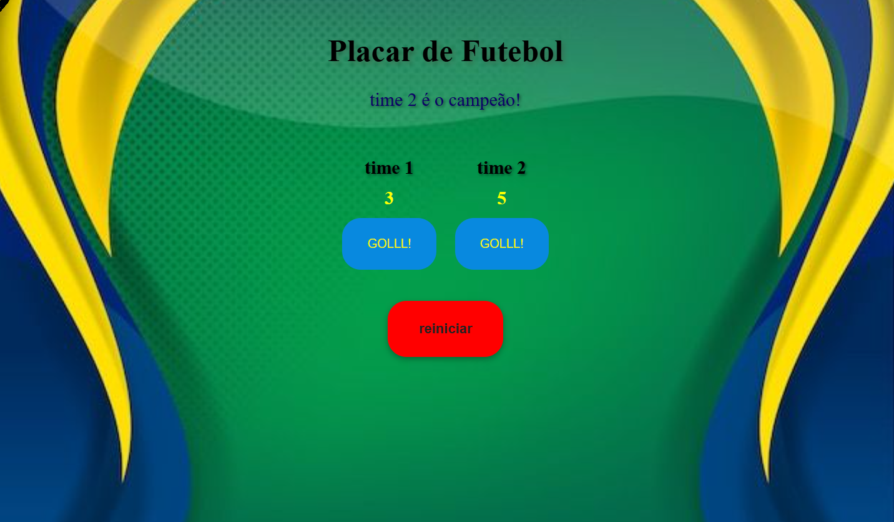

# Placar de Futebol

Uma aplicação web simples e interativa para acompanhar uma partida entre dois times. O projeto foi desenvolvido como uma atividade prática de HTML, CSS e JavaScript, com foco em manipulação do DOM e interação com eventos.

## Demonstração

## Funcionalidades

- Exibe a pontuação de dois times.
- Adiciona um gol ao time correspondente ao clicar em **GOLLL!**.
- Encerra a partida quando um dos times chega a 5 gols, anuncia o campeão e desativa os botões de gol.
- Reinicia a partida, zera o placar e habilita novamente os botões.

## Como executar

1. Clone ou baixe este repositório.
2. Abra o arquivo `index.html` em um navegador moderno.
3. Clique em **GOLLL!** para atualizar o placar ou em **reiniciar** para começar de novo.

Não é necessário instalar dependências nem iniciar um servidor: a aplicação roda diretamente no navegador. É necessária conexão com a internet para carregar a imagem de fundo hospedada externamente.

## Tecnologias

- **HTML** — estrutura da página;
- **CSS** — cores, layout e estilos dos botões;
- **JavaScript** — atualização do placar, verificação do vencedor e reinício da partida.

## Regras da partida

Cada clique no botão de um time acrescenta um gol. O primeiro time a alcançar 5 gols é declarado campeão. Depois do anúncio, os botões de gol ficam desativados até que a partida seja reiniciada.
